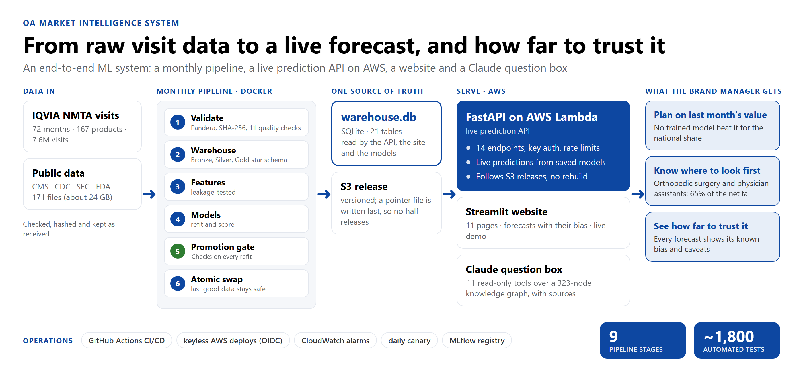
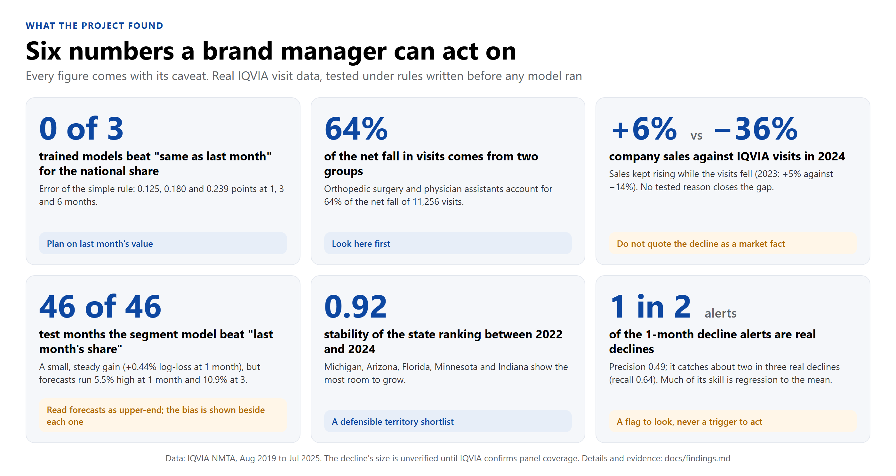

# OA Market Intelligence System


**An end-to-end ML system that forecasts how often doctors choose a knee-osteoarthritis injection (Zilretta) over its rivals, and says plainly how far to trust each forecast.**

It is built like a real product: a monthly data pipeline, a prediction API running on AWS, a website, and a Claude-powered question box, all tested and monitored. Built as a **portfolio project** on real IQVIA visit data.

[**Live website**](https://oa-market-intelligence-system-gc4jn4n6qqdf8mnaliabff.streamlit.app) · [API guide](docs/api.md) · [Architecture](docs/architecture.md) · [All findings](docs/findings.md) · [Decision log](docs/decision_log.md) · [Documentation index](docs/index.md)



## The problem

A newer, long-acting injection (Zilretta) competes with decades-old generic steroid injections and pain pills in a very large osteoarthritis market. Its **brand manager** needs to know:

1. Where is our share of doctor visits heading?
2. Which patient and doctor groups should we look at first?
3. **How far can we trust each forecast?**

Our Project answers the more important question(third), in every number it shows.

## What it found (the business impact)



The same findings in words:

| What a brand manager can now do | What the data showed |
|---|---|
| **Stop planning on a noisy forecast** | No model beat "same as last month" for the overall share. Its error is 0.125, 0.180 and 0.239 points at 1, 3 and 6 months, so the plan stays simple. |
| **Know where to look first** | Orthopedic surgery and physician assistants account for 64% of the net fall of 11,256 visits. |
| **Avoid quoting a number that may be wrong** | Company net sales rose 5% (2023) and 6% (2024) while IQVIA's Zilretta visits fell 14% and 36%. The size of the decline cannot be quoted as a market fact until IQVIA confirms its panel coverage. |
| **Rank groups, with the bias stated** | The segment model beats "last month" in all 46 test months at 1 month (+0.44% log-loss) but runs 5.5% and 10.9% high at 1 and 3 months. A correction cut that to about 1% and 3% in testing; it stays provisional until new months confirm it. |
| **Prioritise territories** | A stable state ranking (0.92 rank correlation) puts Michigan, Arizona, Florida, Minnesota and Indiana first for room to grow. |
| **Get an early warning, not a trigger** | The 1-month decline alert catches about two in three real declines (recall 0.64), but only about half of its alerts are real (precision 0.49). Use it as a flag to look, never to act alone. |

Every forecast on the site and in the API carries its known bias and caveats. The full list of 17 findings is in [`docs/findings.md`](docs/findings.md).

## The live system

| Part | Where it runs | What it does |
|---|---|---|
| **Website** | Streamlit Community Cloud ([open it](https://oa-market-intelligence-system-gc4jn4n6qqdf8mnaliabff.streamlit.app)) | 11 pages: what to use and what not to trust, trends, segments, forecasts with their bias, model results. A "Run the model" panel calls the live API. |
| **Prediction API** | FastAPI in a container on **AWS Lambda** | 14 endpoints, API-key access, rate limits, and live predictions from the saved models. |
| **Data release** | Versioned **S3** bucket | A new month of data reaches the API with no rebuild. |
| **Monitoring** | CloudWatch alarms, email alerts, a daily canary check | Errors, slow responses, and a check that the live data matches the repository. |
| **Delivery** | GitHub Actions | Tests on every change, the monthly pipeline, and AWS deploys with short-lived credentials (no stored keys). |
| **Question box** | Claude, on the website | Answers in plain English from 11 read-only tools over the tables and a 311-node knowledge graph, with its sources. |

The API's address is not published here because this repository is public and the API is key-protected; the [API guide](docs/api.md) lists every endpoint and the same calls work locally (see "Try it" below). The AWS parts run on AWS's Free plan, which ends on 6 May 2027; after that the website still works and its live-model panel says the service is not answering.

**A live call looks like this** (a key is required):

```bash
curl -H "X-API-Key: <your-key>" \
  "https://<function-address>/v1/predict/segment?specialty=PHYSICIAN%20ASSISTANT&age_band=65%20TO%2074&gender=FEMALE&horizon=1"
```

It returns the forecast, last month's value, the change, the visits behind it, and the known bias.

## How it works

The picture at the top shows the whole path. Four detailed diagrams, the reasons for each choice and what happens when something fails are in [`docs/architecture.md`](docs/architecture.md).

**The monthly pipeline** (`oa-publish`) runs nine recorded stages: check the public data, build the warehouse, check it covers every month, build features, store model results, refit the models, **check the refit against the models in service (the promotion gate)**, monitor freshness and drift, then swap the new warehouse in with one atomic rename. If any stage fails, or the gate refuses the refit, the last good data stays live and the run says where it stopped ([`docs/pipeline.md`](docs/pipeline.md)).

## Why you can trust it

- **Rules before results.** Features, tests and pass marks were written down before any model ran. A model has to beat a simple rule reliably, or the simple rule serves.
- **No peeking at the future.** Tests rewrite every value after a forecast date and require the forecast not to move; a deliberate leak must be caught.
- **Honest testing.** Walk-forward validation (always train on the past, test on the next month, 46 times) with intervals from resampling whole months.
- **Reproducible.** The same data, code and seed give byte-identical results; every run records the data, code and environment versions.
- **Tested and gated.** About 1,800 automated tests and seven CI jobs, including an end-to-end run of the real data through every stage twice.
- **Load-tested.** On a laptop the API handled 193 requests per second at 50 users with a 95th-percentile time of about 190 ms and no failures ([`docs/loadtest.md`](docs/loadtest.md)).

## Tech stack

| Layer | Tools |
|---|---|
| Data and warehouse | Python, pandas, Pandera, SQLAlchemy, SQLite (star schema, Bronze/Silver/Gold) |
| Modelling | scikit-learn, statsmodels, SHAP, MLflow (tracking and model registry) |
| Serving | FastAPI, NumPy (saved models are plain coefficients), Streamlit, Claude API |
| Packaging | Docker (pipeline, website, API and an AWS Lambda image) |
| Cloud | AWS Lambda, S3, ECR, CloudWatch, SNS, CloudFormation |
| Automation | GitHub Actions (CI, monthly run, keyless OIDC deploys, daily canary), Dagster (optional orchestrator) |
| Quality | pytest, ruff, Locust (load test) |

## Try it

Python 3.12 is the tested baseline and the packages are pinned ([`docs/environment.md`](docs/environment.md)).

```bash
pip install -r requirements.txt && pip install --no-deps -e .   # then oa-publish, oa-model and others are on the path
docker compose up --build                                        # website on :8501, API on :8000 (docs at /docs)
```

Run the pieces:

```bash
PYTHONPATH=src python -m oa_market_intelligence.publish          # rebuild, check and publish the warehouse (about 75 s)
PYTHONPATH=src python -m pytest                                  # the test suite
API_KEYS=my-key docker compose up --build api                    # the API alone, with a key
curl -H "X-API-Key: my-key" http://localhost:8000/v1/forecasts/national
```

More: the Docker images ([`docs/docker.md`](docs/docker.md)), the monthly run and what to do when a stage fails ([`docs/runbook.md`](docs/runbook.md)), the Dagster orchestrator ([`docs/orchestration.md`](docs/orchestration.md)), the MLflow registry ([`docs/tracking.md`](docs/tracking.md)).

## Honest limits

- **The data end in July 2025.** No newer IQVIA extract exists, so forecasts are for months that have passed. They show the method and a baseline, not a current view, and the system flags its own data as stale.
- **IQVIA's panel coverage is unconfirmed.** If it changed in 2023 or 2024, every model learned from a series with a break in it.
- **The gains are small.** The segment forecast beats the simple rule by about 0.4% of log-loss at 1 month and runs high; there is no reliable gain at 6 months.
- **The bias correction is provisional.** It was chosen after seeing the first results, so it is adopted only if it holds on months after July 2025.
- **The question box** was checked with a scripted client and a 28-question set; the full evaluation against the live model has not been run.
- **Not built, on purpose:** Kubernetes, Spark, a feature store, SageMaker, Terraform and a separate staging environment. Nothing in this problem needs them.

## Where to read more

| Topic | Document |
|---|---|
| The whole system on one page | [`docs/architecture.md`](docs/architecture.md) |
| All findings and the public datasets | [`docs/findings.md`](docs/findings.md) |
| The API and the website | [`docs/api.md`](docs/api.md), [`docs/site.md`](docs/site.md) |
| Models and how they were judged | [`docs/modelling_results.md`](docs/modelling_results.md), [`docs/promotion_gate.md`](docs/promotion_gate.md), model cards in [`docs/`](docs/) |
| Every decision and why | [`docs/decision_log.md`](docs/decision_log.md) |
| Every document and notebook | [`docs/index.md`](docs/index.md) |

## Repository map

```text
src/oa_market_intelligence/   pipeline, warehouse, features, modelling, API, website logic
app/                          the Streamlit website
infra/aws/                    CloudFormation templates (4 stacks)
.github/workflows/            CI, monthly pipeline, deploy, daily canary
loadtest/                     the Locust load test
data/                         raw extracts, reference files, the published warehouse
docs/  notebooks/  tests/     documentation, executed notebooks, about 1,800 tests
```

## Data

The primary dataset is a real IQVIA NMTA patient-visit extract (72 months, 160 products, 7M+ visits), provided for this project. The Excel extracts are committed in [`data/raw/`](data/raw/) with the course instructor's approval under Penn State's data license. A product taxonomy (160 products) is in [`data/reference/`](data/reference/). FDA approval dates come from the free openFDA API; a snapshot is committed so the work reproduces offline. 171 public CMS, CDC, SEC and FDA files (about 24 GB) add outside context ([`docs/findings.md`](docs/findings.md)).
