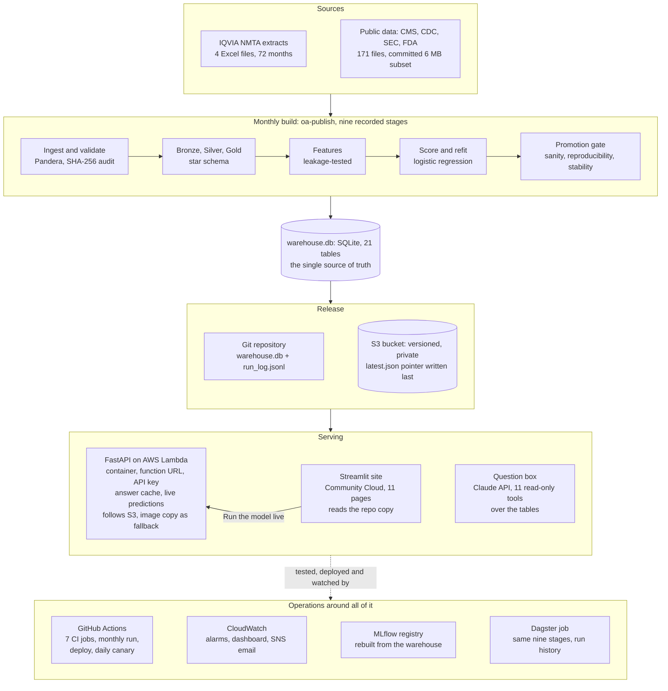
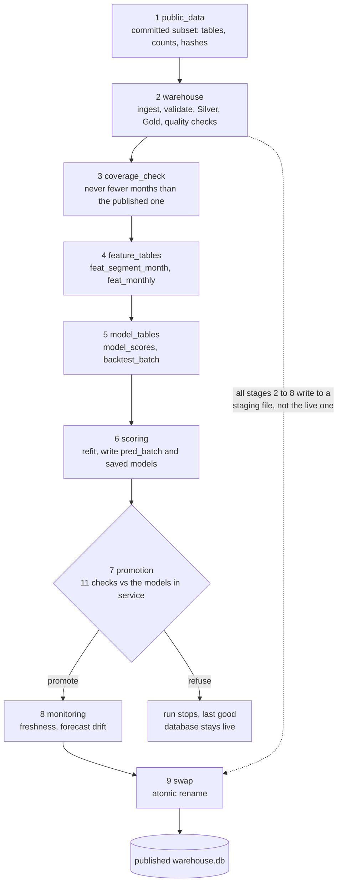
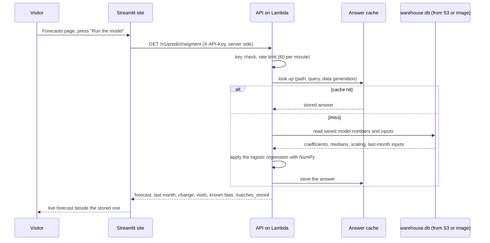
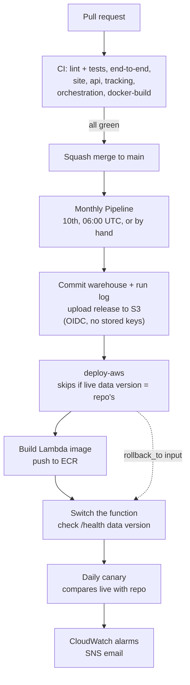

# Technical architecture

One page that shows how the whole system fits together: where the data comes from, how it becomes a
warehouse and a forecast, how a forecast reaches a person, and how a change reaches production. Every box
below is something that exists in this repository and was run; the last section lists what was
deliberately not built. The diagrams are Mermaid, so GitHub draws them.

**In one paragraph.** Four IQVIA extracts and a set of public files are ingested into a Bronze, Silver, Gold
warehouse (a single SQLite file with a star schema). A monthly nine-stage run rebuilds the warehouse, refits
the adopted models, checks the refit with a promotion gate and swaps the new warehouse in atomically. The
warehouse is the one source of truth: a Streamlit site reads it, a FastAPI service reads it (and runs the saved
models live), and a Claude question box reads it through read-only tools. The API runs as a container on AWS
Lambda and follows new releases from S3 without a rebuild. GitHub Actions tests, publishes and deploys, and
CloudWatch watches the result.

## 1. The whole system

## 2. The monthly build: nine stages, one atomic swap

Any stage that fails stops the run, removes the staging area and leaves the live database as it was. Each run
appends one line to `run_log.jsonl` with the stage list, timings, input checksums and the versions of data,
code and environment ([`pipeline.md`](pipeline.md), [`promotion_gate.md`](promotion_gate.md)).

## 3. One request: from a visitor to a forecast

The key and address live in the host's secrets, never in the browser. If the API does not answer, the panel
shows one plain sentence and the rest of the page does not depend on it ([`site.md`](site.md), [`api.md`](api.md)).

## 4. From a change to production

AWS is reached by short-lived tokens from GitHub's OIDC provider; the trust rule names the repository by its
immutable IDs. There are no AWS access keys in GitHub ([`deployment.md`](deployment.md)).

## Components and why each was chosen

| Layer | Technology | Where it runs | Why this and not the alternative |
|---|---|---|---|
| Ingest and validate | Python, pandas, openpyxl, Pandera | the monthly job | The IQVIA files are nested Excel pivots, so a parser plus a schema gate that fails loudly beats a generic loader. |
| Warehouse | SQLite file, SQLAlchemy, star schema (4 dimensions, 2 facts, Gold tables) | repo, S3, the API image | About 150K fact rows. One file can be versioned, hashed, swapped atomically and shipped to Lambda; a database server would add cost and failure modes for no gain at this size. |
| Features and models | scikit-learn, statsmodels, SHAP | the monthly job | Logistic regression is the adopted segment model; a rule ("same as last month") is adopted where nothing beats it. Pre-registered tests decide, not preference. |
| Model serving | NumPy on saved coefficients (`model_artifacts`) | the API | The model is stored as readable numbers, so the API needs no scikit-learn, nothing can break on a library upgrade, and a stored forecast can be checked against a live one (`matches_stored`). |
| API | FastAPI, Mangum, Pydantic | AWS Lambda container (1024 MB, 30 s) behind a function URL | Pay-per-request and idle cost zero; a container image keeps local and cloud identical. Answer cache, key check and rate limit are in the app. |
| Data release | S3 (versioned, private), pointer file written last | AWS | A new month reaches the API with no image rebuild; the API verifies size, checksum, readability, data version and month before switching, and falls back to the image copy. |
| Website | Streamlit | Streamlit Community Cloud | Free, deployed from the repo, tested headlessly in CI. |
| Question box | Claude API with 11 read-only tools | Anthropic, key in the host's secrets | Answers come from tool calls over the tables, with sources and a check on the figures it quotes. |
| Experiment tracking | MLflow (local SQLite store) | optional install | A registry of the models in service with a `champion` alias, rebuilt from the published warehouse so it cannot disagree with what is served. |
| Orchestration | GitHub Actions (scheduled run of record), Dagster (local and container) | both | Actions is free and publishes to S3; Dagster adds the graph, run history, schedule and sensor over the same code. |
| Infrastructure | CloudFormation, four stacks (bootstrap, api, monitoring, data), `cfn-lint` clean | AWS | Declarative, reviewed in pull requests; the OIDC role, ECR, function, bucket and alarms are all in the repo. |
| Monitoring | CloudWatch metric filters on the API's JSON access line, five alarms, a dashboard, SNS email; a daily canary workflow | AWS and GitHub | Alarms on errors and latency, plus a check that the live data version matches the repository's. |
| Tests and CI | pytest (about 1,800 tests collected), ruff, Docker builds, Locust | GitHub Actions | The end-to-end job runs the real extracts through every stage twice and requires identical output. |

## The design decisions an interviewer is most likely to probe

| Decision | Reasoning | Trade-off accepted |
|---|---|---|
| One SQLite warehouse as the single source of truth | The site, the API, the registry and the question box all read the same file, so they cannot disagree. | No concurrent writers; fine because only the monthly job writes. |
| Atomic swap with a staging file | A failed run can never replace the last good data. | A refused refit also holds back that month's data. |
| Promotion gate guards behaviour, not skill | Skill needs new outcomes, which do not exist until later; that is the pre-registered test, a human step. | The gate cannot say a refit is better, only that it is sane, reproducible and stable. |
| Models stored as numbers, applied with NumPy | Readable, comparable and independent of library versions. | Only models that are a few coefficients can be served this way. |
| Pointer written last in the S3 release | A reader never sees a half-written release. | One extra object to manage. |
| Answer cache keyed by data generation | The answers are pure functions of the loaded data, so the cheapest request is the one not computed. | A bounded cache (512 entries) with private copies; errors are never stored. |
| Pre-registered tests, null results reported | Rules written before any model ran. The honest finding is that nothing beats "same as last month" for the national share. | The headline is modest, by design. |
| Serving and orchestration kept thin | The pipeline code is one implementation with two drivers (`oa-publish` and Dagster). | Dagster runs in dev mode, one process. |

## What happens when something fails

| Failure | What the system does |
|---|---|
| A pipeline stage fails | The run stops, the staging area is removed, the live database is untouched, the stage is named in `run_log.jsonl`. |
| The promotion gate refuses the refit | The run stops before the swap; an override needs a written reason, which is recorded. |
| S3 is down or a release is damaged | The API keeps serving what it has (the image copy at start-up). |
| The API is unreachable from the site | The live panel shows one sentence; the rest of the page is unaffected. |
| A bad deploy | `/health` data version is checked after the switch; `deploy-aws` can be re-run with `rollback_to`; the daily canary and CloudWatch alarms notify by email. |
| The data are old | Monitoring reports freshness (the extract ends July 2025), and the site says so. |

## Deliberately not built

Kubernetes, Spark, a feature store and SageMaker were left out because nothing in this problem needs them (a
150K-row warehouse, a handful of linear models, a monthly refresh). Terraform, a secrets-manager store, a
separate staging environment, image scanning and automatic rollback were also dropped (roadmap item 7, a
choice made on 7 Nov 2026): the project works without them, the CloudFormation templates already pass
`cfn-lint`, and a rewrite would risk the live system. With a production budget these are what to add first.

## Not verified

- Behaviour under the keyed live load (only the unauthenticated `/health` was load-tested on the live function).
- A real new IQVIA extract: the monthly refresh is exercised by tests and the schedule on the same data.
- The Dagster schedule and sensor (off by default, never fired).
- The AWS parts run on the Free plan, which ends on 6 May 2027; after that the live panel reports the service
  as not answering.
- The question box has been run with a scripted client and a 28-question set; the full check against the live
  model has not been run.

## Where to find things

| Looking for | Go to |
|---|---|
| The nine stages and the run record | `src/oa_market_intelligence/publish.py`, [`pipeline.md`](pipeline.md) |
| The warehouse tables | `src/oa_market_intelligence/warehouse/`, [`database_schema.md`](database_schema.md) |
| Features and the pre-registered tests | `features/`, `modeling/`, [`feature_results.md`](feature_results.md), [`modelling_results.md`](modelling_results.md) |
| The promotion gate | `promotion.py`, [`promotion_gate.md`](promotion_gate.md) |
| The API | `api/`, [`api.md`](api.md) |
| The S3 release | `data_release.py`, `api/remote_data.py`, [`deployment.md`](deployment.md) |
| The website | `app/`, `serving/`, [`site.md`](site.md) |
| Infrastructure | `infra/aws/`, `.github/workflows/` |
| MLflow and Dagster | `tracking.py`, `orchestration.py`, [`tracking.md`](tracking.md), [`orchestration.md`](orchestration.md) |
| Every decision and why | [`decision_log.md`](decision_log.md) |
